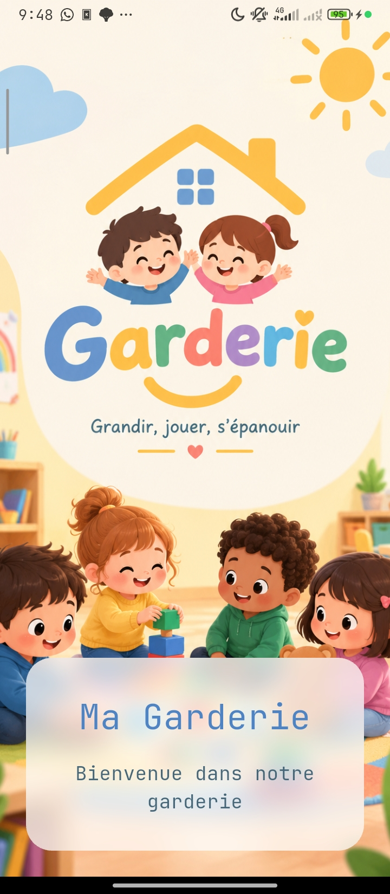
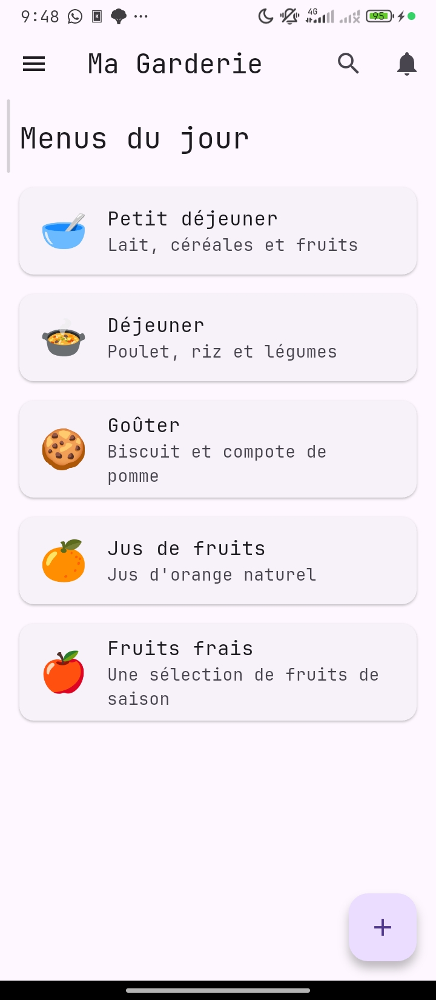
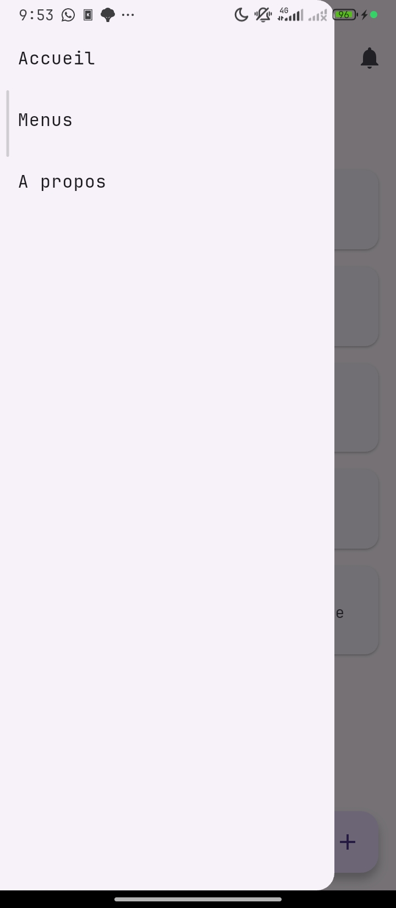
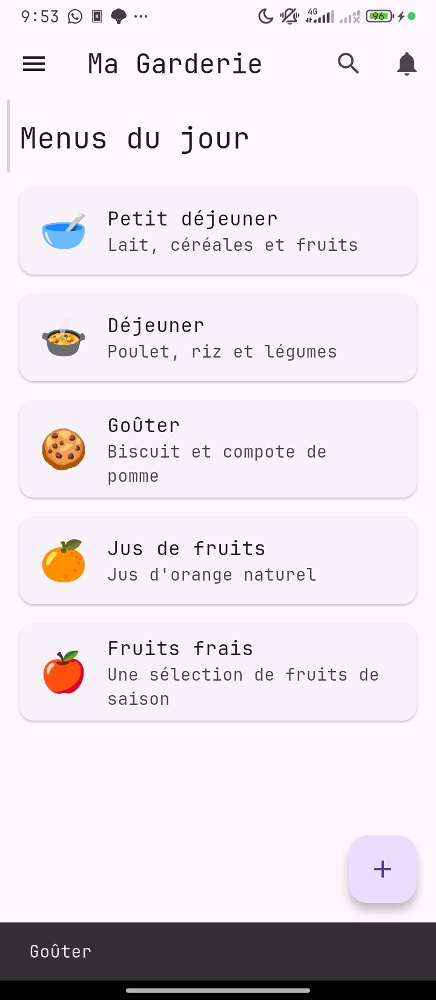

# Ma Garderie

## Présentation

Ma Garderie est une application mobile développée avec Flutter. Elle permet d'afficher les menus d'une garderie et d'interagir avec les différents éléments de l'application.

## Technologies utilisées

- Flutter
- Dart
- Material Design

## Installation et exécution

1. Cloner le dépôt GitHub :

   ```bash
   git clone https://github.com/zidi-abderrahmen/garderie-mobile-g2.git
   ```

2. Entrer dans le dossier du projet :

   ```bash
   cd ma_garderie
   ```

3. Installer les dépendances :

   ```bash
   flutter pub get
   ```

4. Lancer l'application :

   ```bash
   flutter run
   ```

## Captures d'écran

<table width="100%">
  <tr>
    <td align="center" width="50%">
      <strong>Splash Screen</strong><br><br>
      
    </td>
    <td align="center" width="50%">
      <strong>Page principale avec les menus</strong><br><br>
      
    </td>
  </tr>
  <tr>
    <td align="center" width="50%">
      <strong>Drawer ouvert</strong><br><br>
      
    </td>
    <td align="center" width="50%">
      <strong>Message après une interaction</strong><br><br>
      
    </td>
  </tr>
</table>